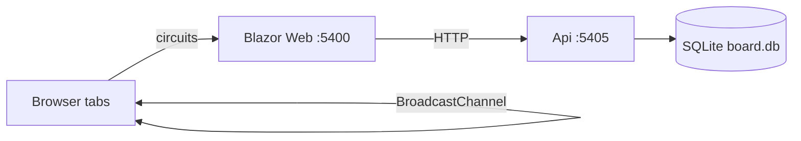

# MvpBoardBroadcastDb — implementation

## Architecture

| Concern | Approach |
| --- | --- |
| Live cross-tab UI | `BroadcastChannel` via JSInterop (`crossTabChannel.js` → `CrossTabBus`) |
| Persist moves | Dropping tab calls `POST /api/board/move` |
| Refresh / new tab | `GET /api/board` on page init |
| Database | EF Core + SQLite (`EnsureCreated` + seed) |

Aspire AppHost orchestrates Api + Web (no Redis/Postgres/SignalR) — smaller than `MvpAspirePostgres`.

## Responsibilities

- **Dropping tab:** update local list → save to API → publish `DropAccepted` on the channel.
- **Other tabs:** apply `ItemMoved` from the channel only (no duplicate save).
- **Refresh:** ignore in-memory / channel state; reload from API.

## API

| Method | Path | Purpose |
| --- | --- | --- |
| GET | `/api/board` | All items |
| POST | `/api/board/move` | `{ itemId, zoneId }` |

Zones: `tray`, `inbox`, `archive`.

## Ports

| Resource | URL |
| --- | --- |
| AppHost | `dotnet run --project AppHost` |
| web | http://127.0.0.1:5400 |
| api | http://127.0.0.1:5405 |
