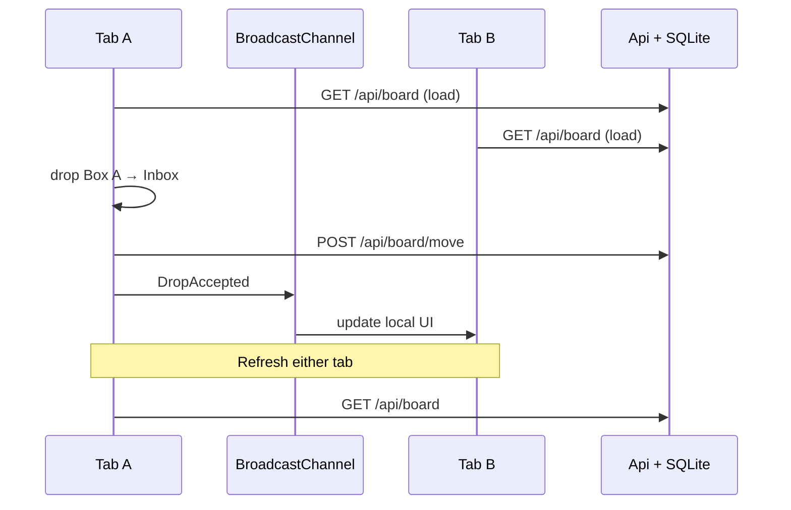

# MvpBoardBroadcastDb

Simplest full-stack board MVP:

- **Web** — Blazor Server board + `BroadcastChannel` (JSInterop) for live cross-tab sync
- **Api** — minimal HTTP API + **SQLite** (EF Core) for persistence

Move a box → API saves `zoneId` → other open tabs update via BroadcastChannel → refresh loads the DB.

## Run

One command (Aspire AppHost starts Api + Web):

```bash
dotnet run --project AppHost
```

| App | URL |
| --- | --- |
| Web | http://127.0.0.1:5400 |
| Api | http://127.0.0.1:5405 |
| Aspire dashboard | launched by AppHost |

Open `/board` in two windows, drag boxes, then refresh — state comes back from SQLite (`Api/board.db`).

Standalone (without Aspire) still works: `dotnet run --project Api` and `dotnet run --project Web`.

## Flow



See [IMPLEMENTATION.md](./IMPLEMENTATION.md) for details.
